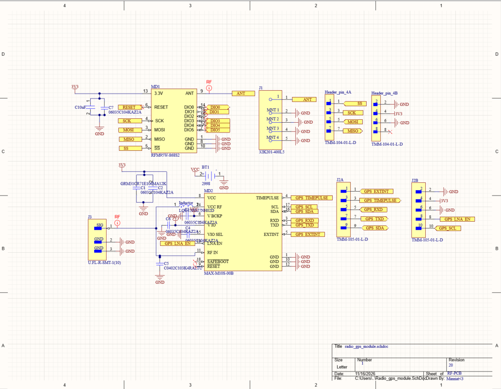
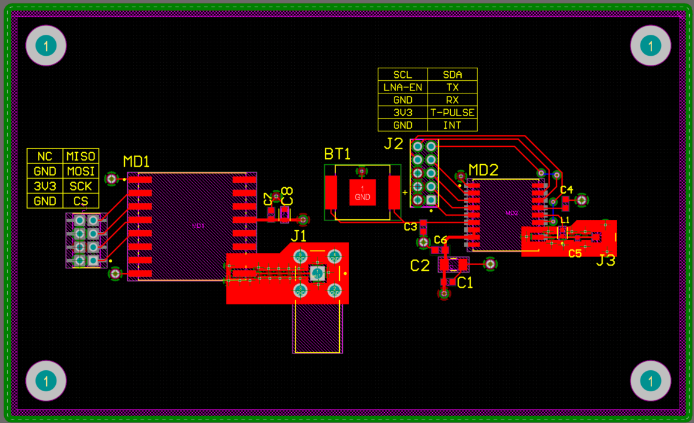
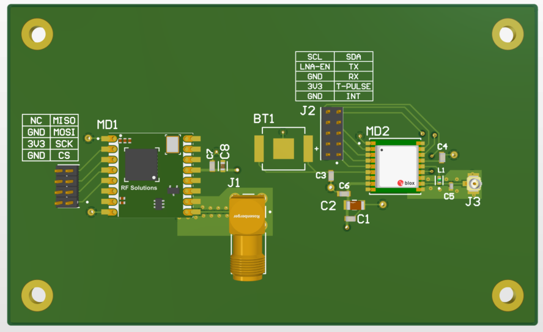

# GPS and LoRa PCB Design

A custom PCB designed using **Altium Designer**, integrating GPS and LoRa communication modules on a single board. This project explores schematic capture, component integration, PCB layout, routing and hardware design.

## Project Overview

The board combines a LoRa RF module and a GPS receiver, with dedicated interfaces for communication, external connections and antenna integration.

The design focuses on bringing together multiple electronic components into a compact PCB while organising power, signal connections and peripheral interfaces.

## Hardware Components

| Component | Description |
|---|---|
| RFM95W-868S2 | LoRa RF transceiver module |
| MAX-M10S | GPS/GNSS receiver module |
| Antenna connectors | RF antenna interfaces |
| Capacitors | Power supply decoupling and filtering |
| Battery connector | External power connection |
| Pin headers | External communication and peripheral interfaces |

## Design Features

- Schematic design and component integration
- PCB component placement and routing
- LoRa communication interface using SPI
- GPS interfaces including UART and I2C
- External pin headers for signal accessibility
- Power supply and decoupling circuitry
- PCB layout and manufacturing preparation

## PCB Design

The PCB was designed in Altium Designer, covering the process from schematic capture to physical board layout.

### Schematic

    

### PCB Layout

  

### 3D model

    

## Tools & Technologies

- Altium Designer
- Electronic Design Automation (EDA)
- PCB Layout and Routing
- Schematic Capture
- LoRa Communication
- GPS/GNSS Integration
- SPI, UART and I2C interfaces

## What I Learned

This project provided practical experience in translating a circuit schematic into a physical PCB layout, integrating communication modules, managing component connections and organising external hardware interfaces.

It also helped develop my understanding of the relationship between circuit design, component placement and PCB routing.
